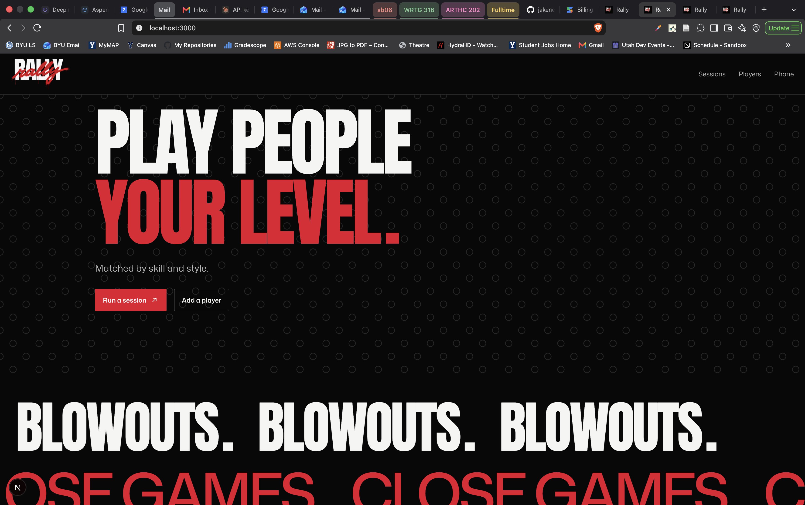
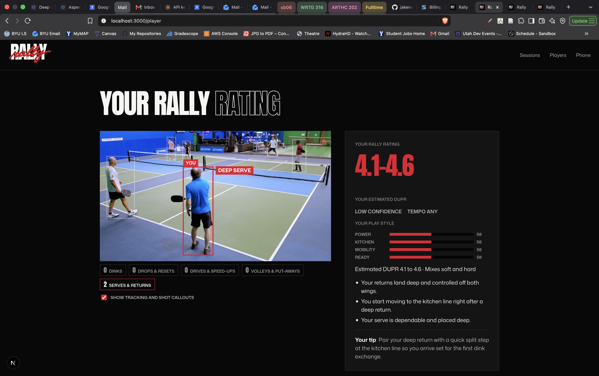
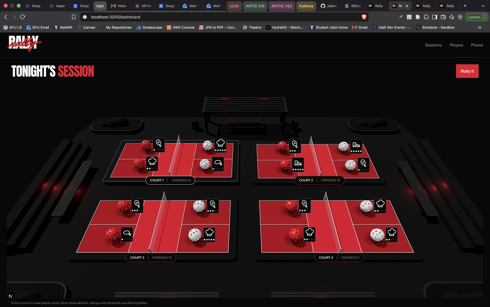
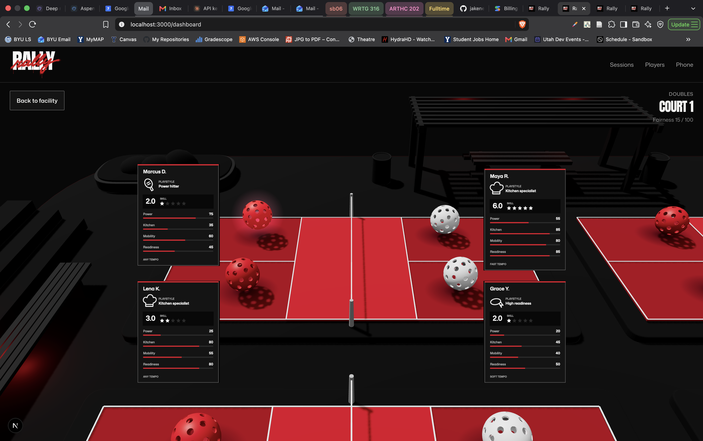

# Rally

Balanced pickleball sessions for facilities.

> DUPR tells you what you are. Rally decides who you should play tonight, and fills the court when someone bails.

A hackathon proof of concept, built for the Utah hackathon (Best Commerce Project track), November 2026. Not a business yet: anything the demo doesn't need is faked. This repo is the whole team's second brain: the idea, the research, our meeting notes, the specs and the code all live here, so any teammate or coding agent can pick up where someone left off.

## Screenshots

### Home

### Player rating

Video analysis, shot callouts, and an estimated DUPR with a player style profile.

### Facility overview

Tonight's courts, player styles, and fairness scores in the facility dashboard.

### Court details

Player cards show each team's skill and play style.

## Folders

| Folder | What goes in it |
| --- | --- |
| `idea/` | What we're building and why: the pitch, positioning against DUPR, the idea history |
| `research/` | What we found out: open-source repos and models, competitors, facility software, open questions |
| `meeting-recordings/` | Recordings, transcripts and notes from our meetings and calls |
| `specs/` | Module specs for the product. Spec first, then code. Start at `specs/README.md` |
| `product/` | The code, the build plan (`BUILD.md`) and the judgment calls we made (`DECISIONS.md`) |
| `demo/` | Demo scenes and options, the stage script, and the list of YouTube clips (videos stay out of git) |
| `brand-assets/` | Logo, colors, screenshots for the pitch |

## Start here

- New to the project: `idea/pitch.md`, then `specs/000-overview.md`.
- Writing code (person or agent): read `AGENTS.md` first.
- Preparing the pitch: `demo/README.md`.
